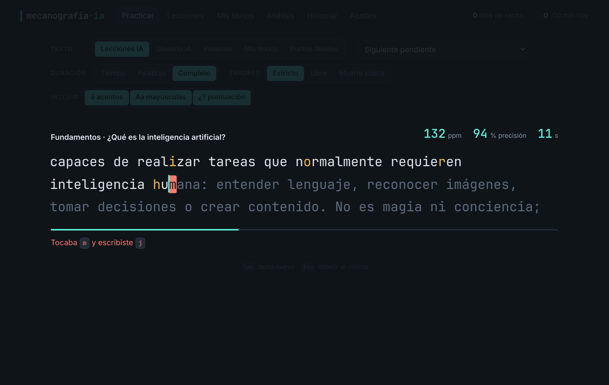

# Mecanografía IA

Web app de mecanografía para **aprender inteligencia artificial mientras tecleas**. Sin instalación, sin servidor y sin cuentas: tus datos se quedan en tu navegador y puedes exportarlos cuando quieras.

## Cómo usarla

- **En local:** abre `index.html` con doble clic (no necesita servidor ni compilación).
- **En línea (GitHub Pages):** https://vuneit450.github.io/Mecanografia/ — cada push a `main` copia la app a la rama `gh-pages` (`.github/workflows/pages.yml`). En *Settings → Pages* la fuente debe ser *Deploy from a branch*, rama `gh-pages`, carpeta `/ (root)`.

## Qué puedes hacer

| Acción | Dónde |
|---|---|
| Escribir una ruta de 33 lecciones de IA de unas 650 palabras (unos 10 min a 60 ppm); se pueden hacer por partes y cada una termina con su idea clave | Practicar · Lecciones |
| Practicar definiciones del glosario de IA o palabras frecuentes del español | Practicar → Texto |
| **Añadir textos propios** (pegados o desde un `.txt`/`.md`); en textos largos recuerda por dónde vas | Mis textos |
| **Por tiempo** (15/30/60/120 s), por número de palabras (10/25/50/100) o texto completo | Practicar → Duración |
| **No avanzar hasta escribir bien** (modo estricto), modo libre con retroceso, o muerte súbita | Practicar → Errores |
| Quitar o conservar acentos, mayúsculas y puntuación | Practicar → Incluir |
| **Ver puntos débiles**: teclas, combinaciones, confusiones, palabras, dedos, mapa de calor del teclado | Análisis |
| Práctica generada con tus teclas y combinaciones más débiles | Practicar → Puntos débiles |
| Repasar solo las palabras que fallaste en la última prueba | Resultados |
| Ver evolución de velocidad y precisión, racha y meta diaria | Análisis · cabecera |
| **Exportar tus datos** (JSON completo, CSV de sesiones, CSV de cada pulsación) e importarlos | Historial |
| Temas, tamaño de letra, cursor fantasma, sonido, modo enfoque | Ajustes |

Atajos: `Tab` texto nuevo · `Esc` repetir el mismo · `Enter` siguiente (en resultados).

## Tus datos

Cada prueba guarda sus métricas y **todas las pulsaciones** (posición, carácter esperado, carácter tecleado, milisegundos, acierto). Desde *Historial* se exporta a:

- `mecanografia-AAAA-MM-DD.json`: copia completa (sesiones, textos, progreso, ajustes). Sirve para respaldo o para pasar a otro equipo.
- `mecanografia-sesiones-*.csv`: una fila por prueba (ppm, precisión, consistencia, formato…).
- `mecanografia-pulsaciones-*.csv`: una fila por tecla pulsada, con latencia y carácter anterior. Listo para Excel, Python o Tableau.

El diseño completo (investigación, estructura, modelo de datos y fórmulas) está en [docs/DISENO.md](docs/DISENO.md).

## Nube (sincronización entre equipos)
En **Historial → Nube** pon la misma llave (mínimo 12 caracteres) en cada equipo. Al abrir la app y
después de cada cambio, la app baja la copia de la nube, la une con la local (no reemplaza; lo borrado
en un equipo se borra en los demás) y sube el resultado. Los ajustes visuales son de cada equipo.

- Servidor: `nube/worker.js`, un Worker de Cloudflare con un Durable Object por llave. Solo guarda el
  SHA-256 de la llave, nunca la llave.
- Dirección: `https://mecanografia-sync.jesusjonathan171.workers.dev` (constante `API` en `js/nube.js`).
- Pruebas: `node --test nube/worker.test.mjs`.
- Publicación: `.github/workflows/nube.yml` en cada push que toque `nube/`. Necesita los secretos
  `CLOUDFLARE_API_TOKEN` y `CLOUDFLARE_ACCOUNT_ID` en el repositorio.
